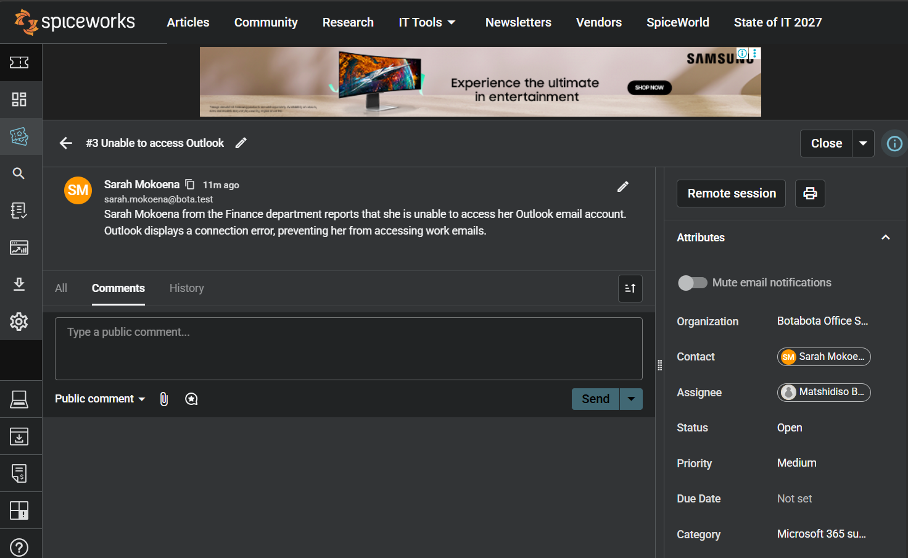
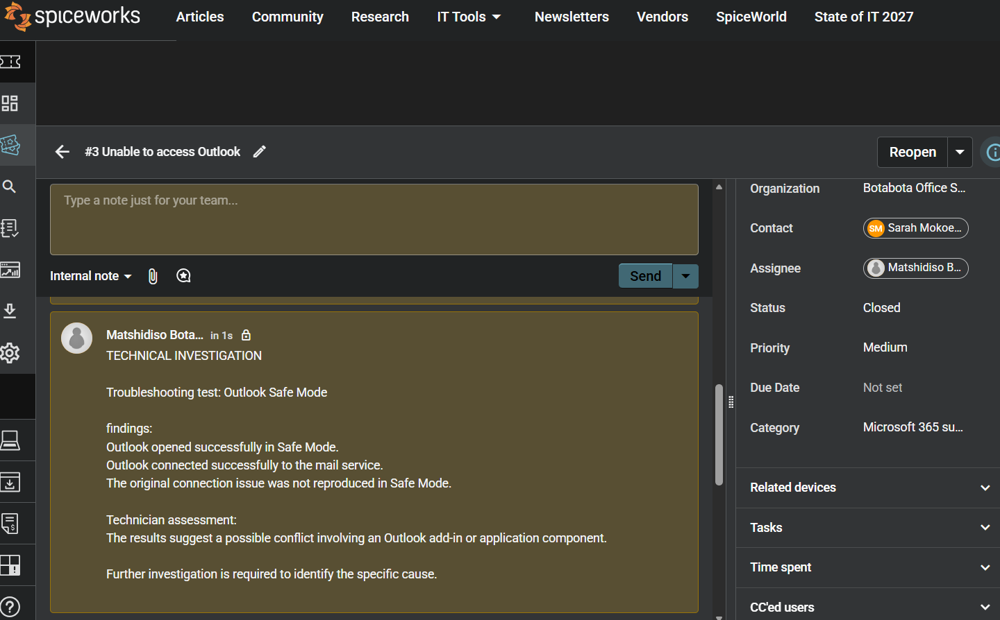
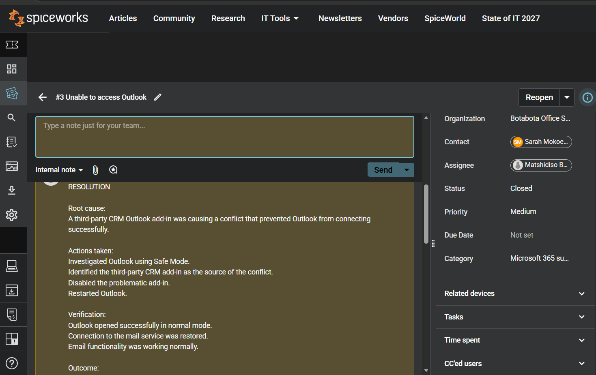
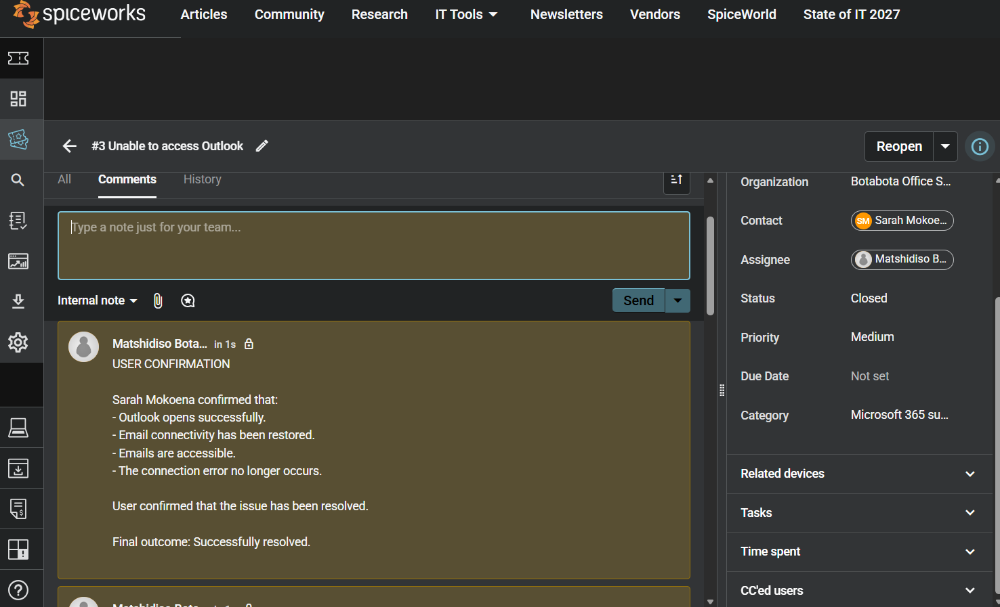

# Incident 001 - Outlook Connectivity Issue

## Ticket Information

| Field | Details |
|---|---|
| Ticket ID | INC001 |
| Requester | Sarah Mokoena |
| Department | Finance |
| Assigned Technician | IT Support |
| Category | Microsoft 365 |
| Priority | Medium |
| Status | Closed |
| Platform | Spiceworks Cloud Help Desk |

## 1. Problem Description

Sarah Mokoena from the Finance department reported that her Outlook desktop application was unable to connect to the mail server. She could access her email through Outlook on the web, but the desktop application displayed a connection error.

## 2. Initial Investigation

The following information was gathered during the initial assessment:

- Internet connectivity was working normally.
- Outlook on the web was accessible.
- Other Microsoft 365 applications were functioning correctly.
- The issue affected only one employee.
- Outlook displayed a disconnected status.

## 3. Troubleshooting Performed

The following troubleshooting steps were simulated:

1. Verified that internet connectivity was available.
2. Confirmed that Outlook on the web was functioning.
3. Checked the status of other Microsoft 365 applications.
4. Opened Outlook in Safe Mode to investigate possible add-in conflicts.
5. Identified a third-party CRM add-in as the source of the problem through controlled testing.

## 4. Root Cause

A third-party CRM Outlook add-in was causing a conflict that prevented the desktop application from connecting successfully.

## 5. Resolution

The problematic CRM add-in was disabled, and Outlook was restarted.

## 6. Verification

The following results were recorded after the simulated resolution:

- Outlook opened successfully in normal mode.
- Connection to the mail service was restored.
- Email functionality was working normally.
- No further connection errors were reported.

Sarah subsequently confirmed that she could access her emails successfully.

## 7. Final Outcome

**Status:** Closed

**Resolution:** Successfully resolved.

**Result:** Outlook connectivity restored.

## Skills Demonstrated

- IT ticket management using Spiceworks.
- Incident categorisation and prioritisation.
- User communication and support.
- Microsoft 365 troubleshooting.
- Root-cause analysis.
- Technical documentation.
- Incident resolution and verification.

---

*Note: This is a simulated IT support incident created for practical learning and demonstration purposes. All users, communications, investigation findings and resolution results are fictional.*
