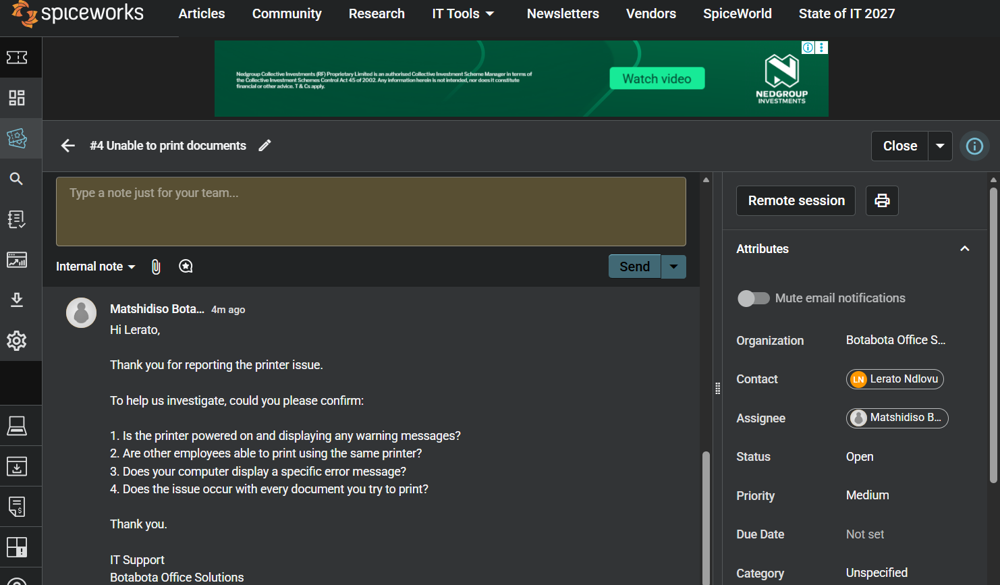
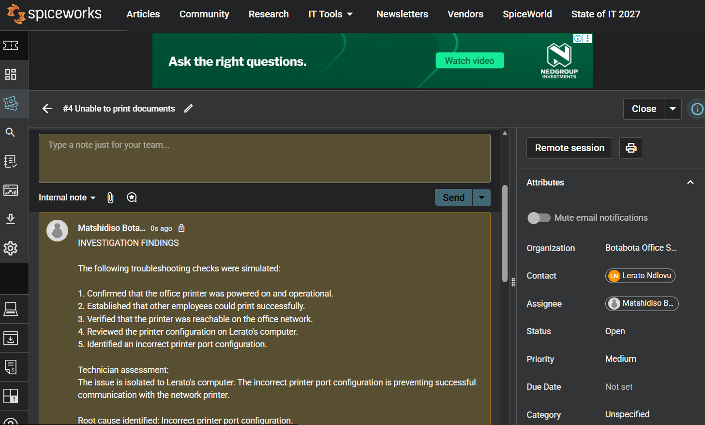
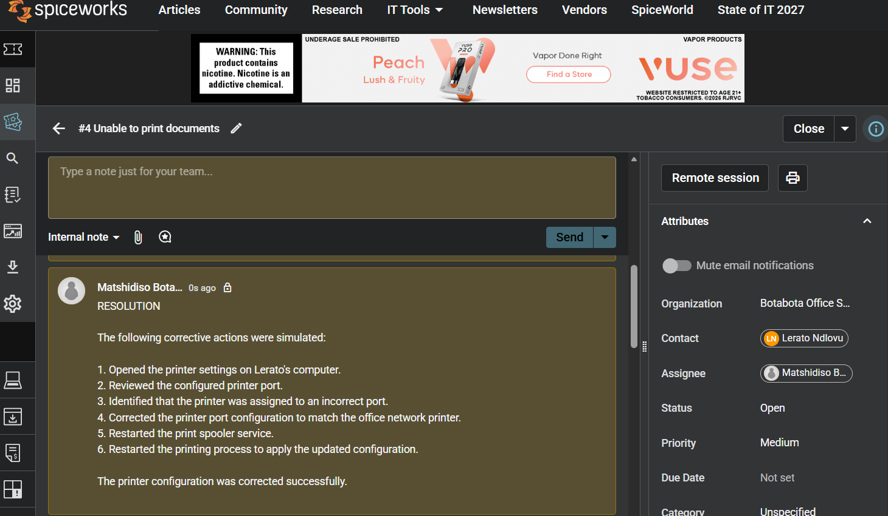
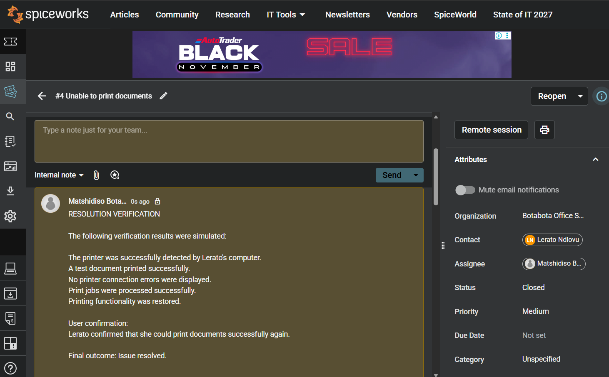

# Incident 002 - Printer Connectivity Issue

## Ticket Information

| Field | Details |
|---|---|
| Ticket ID | INC002 |
| Requester | Lerato Ndlovu |
| Department | Administration |
| Assigned Technician | IT Support |
| Category | Hardware |
| Priority | Medium |
| Status | Closed |
| Platform | Spiceworks Cloud Help Desk |

## 1. Problem Description

Lerato Ndlovu from the Administration department reported that she was unable to print documents using the office network printer. Her computer displayed a printer connection error, and print jobs remained in the queue.

## 2. Initial Investigation

The following information was gathered from the simulated user report:

- The printer was powered on.
- No warning lights or error messages were displayed.
- Other employees could print successfully.
- The issue affected only Lerato's computer.
- All printing attempts resulted in a connection error.

## 3. Troubleshooting Performed

The following troubleshooting steps were simulated:

1. Checked the printer's power and operational status.
2. Confirmed that other employees could print successfully.
3. Verified that the printer was reachable on the office network.
4. Reviewed the printer configuration on Lerato's computer.
5. Identified an incorrect printer port configuration.

## 4. Root Cause

An incorrect printer port configuration on Lerato's computer was preventing successful communication with the network printer.

## 5. Resolution

The following corrective actions were simulated:

- Corrected the printer port configuration.
- Restarted the print spooler service.
- Restarted the printing process.

## 6. Verification

The simulated verification produced the following results:

- The printer was detected successfully.
- A test document printed successfully.
- Print jobs were processed normally.
- No further connection errors were reported.

Lerato subsequently confirmed that she could print documents successfully.

## 7. Final Outcome

**Status:** Closed

**Resolution:** Incorrect printer port configuration corrected.

**Result:** Printing functionality restored.

## Skills Demonstrated

- IT ticket management using Spiceworks.
- Hardware and printer troubleshooting.
- Network printer connectivity.
- Printer configuration.
- Root-cause identification.
- Incident documentation and resolution.

*Note: This is a simulated IT support incident created for practical learning and demonstration purposes. The company, requester, communications, investigation findings and resolution results are fictional.*
