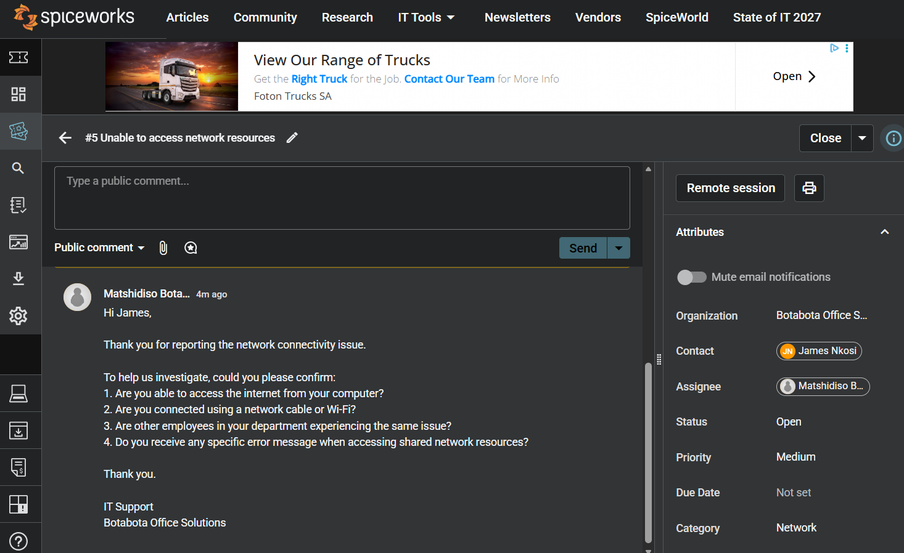
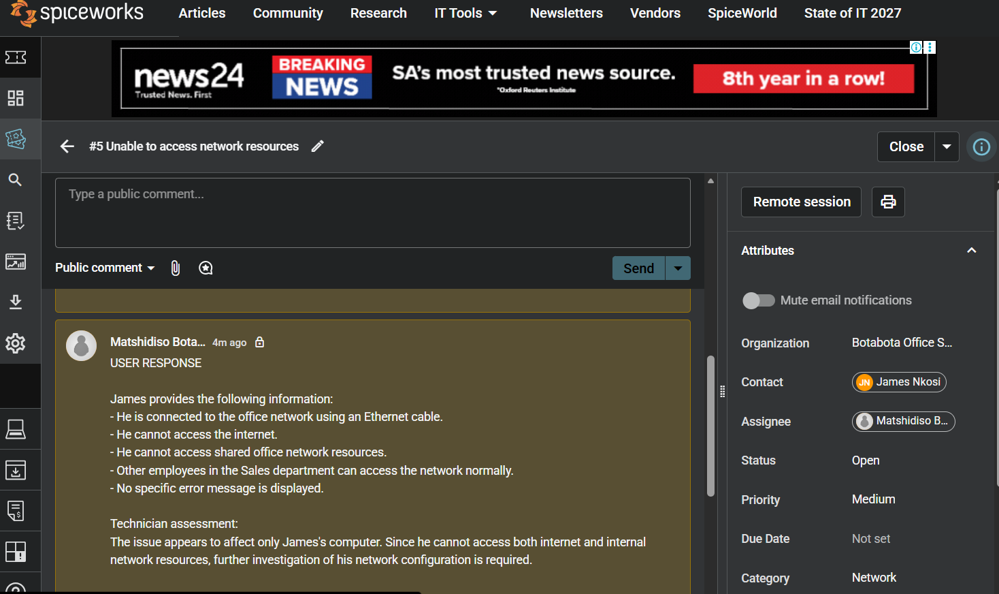
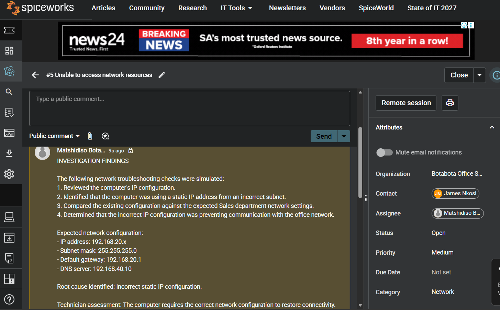
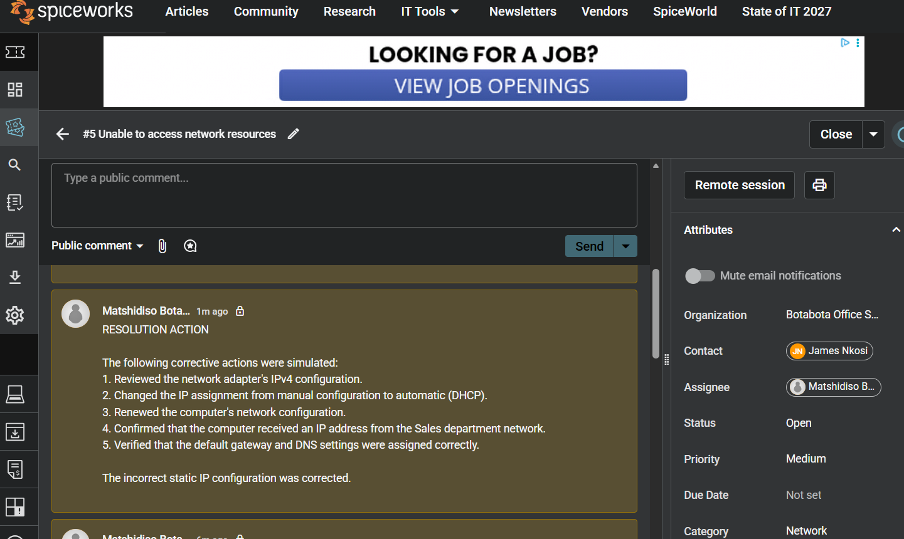
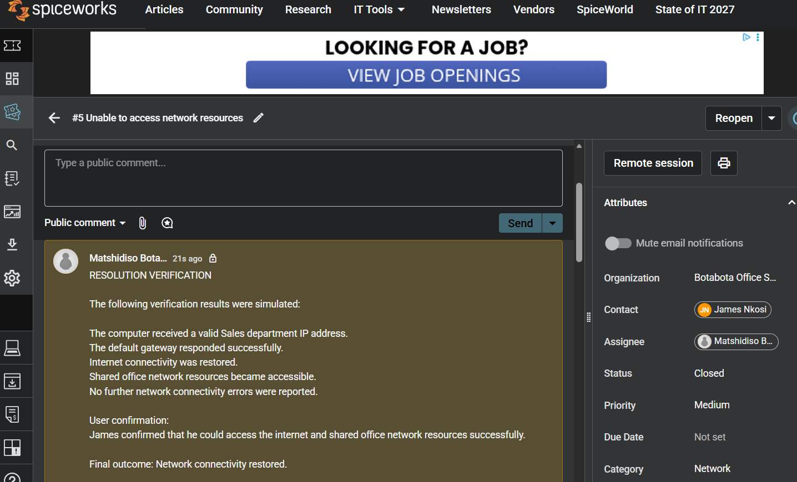

# Incident 003 - Network Connectivity Issue

## Ticket Information

| Field | Details |
|---|---|
| Ticket ID | INC003 |
| Requester | James Nkosi |
| Department | Sales |
| Assigned Technician | IT Support |
| Category | Networking |
| Priority | Medium |
| Status | Closed |
| Platform | Spiceworks Cloud Help Desk |

## 1. Problem Description

James Nkosi from the Sales department reported that he was unable to access shared office network resources or the internet from his computer.
## 2. Initial Investigation

The following information was gathered from the user report:

- The computer was connected through Ethernet.
- Internet access was unavailable.
- Shared network resources were inaccessible.
- Other employees in the department were not affected.
- No specific error message was displayed.

- 

## 3. Troubleshooting Performed

The following troubleshooting steps were taken:

1. Reviewed the computer's IP configuration.
2. Identified an incorrect static IP address from a different subnet.
3. Compared the existing settings with the expected Sales department network configuration.
4. Determined that the incorrect configuration was preventing network communication.

### Expected Network Configuration

| Network Setting | Expected Value |
|---|---|
| IP Address | 192.168.20.x |
| Subnet Mask | 255.255.255.0 |
| Default Gateway | 192.168.20.1 |
| DNS Server | 192.168.40.10 |

## 4. Root Cause

The computer had an incorrect static IP configuration that prevented it from communicating with the Sales department network.

## 5. Resolution

The following corrective actions were taken:

- Changed the network adapter from manual IP configuration to automatic DHCP.
- Renewed the computer's network configuration.
- Confirmed that the correct Sales department network settings were assigned.

## 6. Verification

The verification produced the following results:

- A valid Sales department IP address was assigned.
- The default gateway responded successfully.
- Internet connectivity was restored.
- Shared office network resources became accessible.
- No further connectivity errors were reported.

James subsequently confirmed that network access was restored.

## 7. Final Outcome

**Status:** Closed

**Resolution:** Incorrect static IP configuration corrected.

**Result:** Internet and internal network connectivity restored.

## Skills Demonstrated

- IT ticket management using Spiceworks.
- TCP/IP configuration.
- DHCP troubleshooting.
- Default gateway and DNS configuration.
- Network connectivity testing.
- Root-cause identification.
- Incident documentation and resolution.

*Note: This is a simulated IT support incident created for practical learning and demonstration purposes. All users, communications, investigation findings and resolution results are fictional.*
