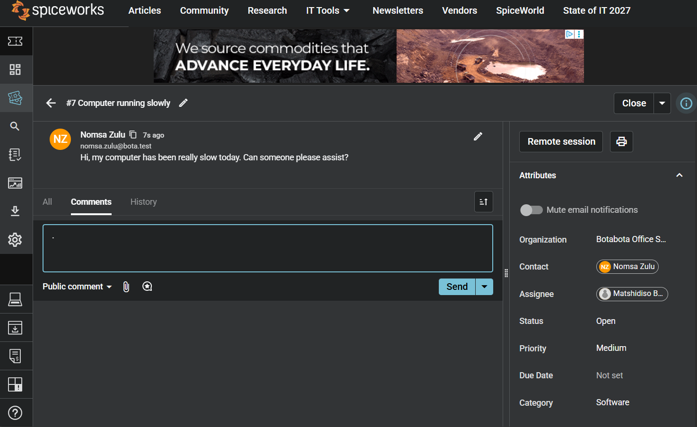
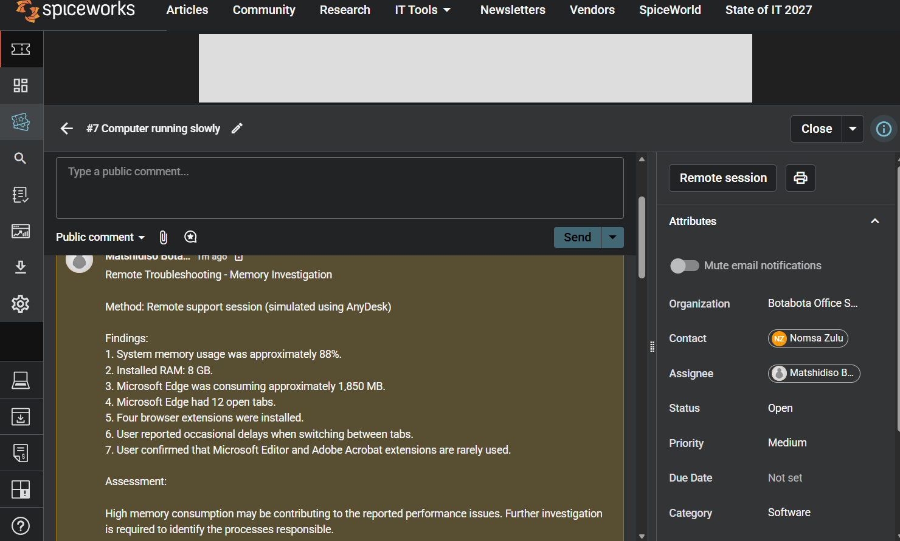
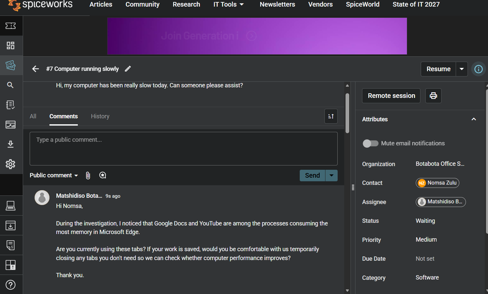
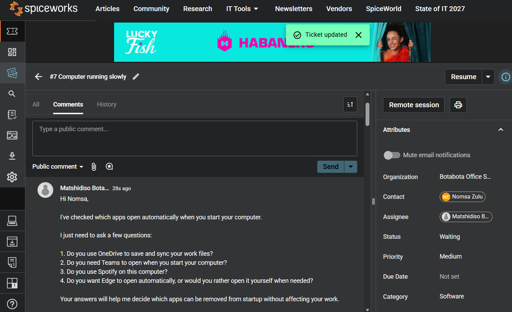
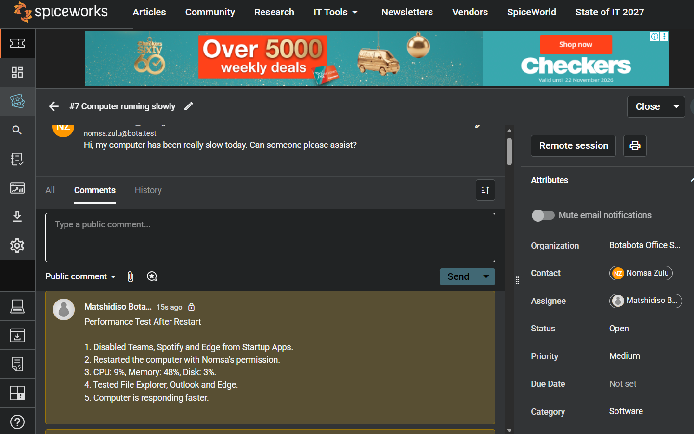
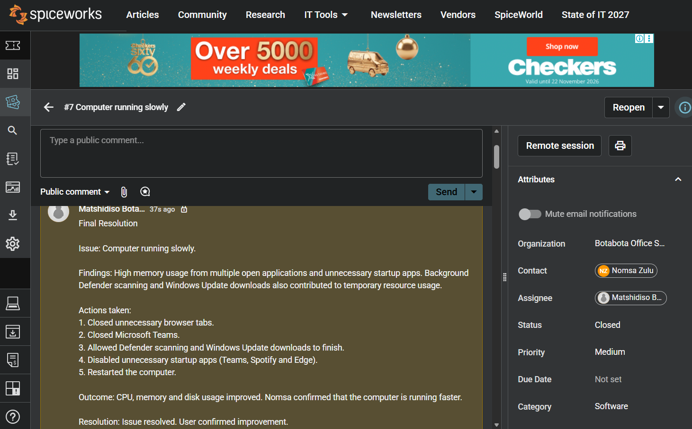

# Incident 4: Computer Running Slowly

## Incident Overview

| Field | Details |
|---|---|
| Ticket | Incident 4 |
| Issue | Computer running slowly |
| Requester | Nomsa Zulu |
| Priority | Normal |
| Category | Software|
| Status | Resolved |

## 1. Problem Description

Nomsa Zulu reported that her computer had been running slowly since the morning. Applications were taking longer to respond, and the overall system performance had decreased.

The issue affected the entire computer rather than one specific application.

## 2. Initial Investigation

The following questions were asked to understand the problem:

- When did the issue start?
- Was the computer working normally before?
- Were all applications affected?
- Were there any error messages?
- Were other employees experiencing the same issue?

**User feedback:**
- The computer was working normally the previous day.
- The issue started that morning.
- All applications were affected.
- No error messages appeared.
- Other employees were not experiencing the same problem.

## 3. Remote Troubleshooting

Remote troubleshooting was simulated using AnyDesk with the user's permission.

Task Manager was used to investigate system performance.

### Memory Investigation

Initial memory usage was approximately 88%.

Microsoft Edge was using a significant amount of memory, with several browser tabs and extensions running.

**Action taken:**
- Reviewed open browser tabs.
- Closed unnecessary tabs with the user's permission.
- Memory usage decreased to approximately 71%.

Microsoft Teams was also using memory but was not needed at the time. It was closed normally with the user's permission.

Memory usage decreased further to approximately 63%.

### Disk Investigation

Initial disk utilisation was approximately 78%.

The following background activities were identified:

- Microsoft Defender scheduled quick scan.
- Windows Update downloading updates.

No security alerts were reported.

**Action taken:** Allowed the security scan and update downloads to finish without interrupting them.

### CPU Investigation

Initial CPU usage was approximately 18%.

Microsoft Defender was one of the main processes using CPU resources during the investigation.

After the background activities completed, CPU usage decreased.

## 4. Startup Applications

Startup applications were reviewed in Task Manager.

The following applications had unnecessary startup activity:

- Microsoft Teams – High impact
- Microsoft Edge – Medium impact
- Spotify – Medium impact

After confirming with Michael, these applications were disabled from starting automatically.

OneDrive and Windows Security notifications were left enabled because they were needed.

## 5. Performance Test

After making the changes, the computer was restarted with the user's permission.

The following simulated Task Manager readings were recorded:

| Resource | Before | After |
|---|---:|---:|
| CPU | 18% | 9% |
| Memory | 63% | 48% |
| Disk | 78% | 3% |

The computer was tested by:
- Opening File Explorer.
- Switching between applications.
- Opening Microsoft Outlook.
- Opening Microsoft Edge.

The computer responded faster during testing.

## 6. Resolution

Nomsa was contacted to confirm whether the performance had improved.

She confirmed that:
- The computer was much faster.
- Folders opened normally.
- Applications switched without noticeable delays.

**Final status:** Resolved.

## 7. Skills Demonstrated

- Spiceworks ticket management
- User communication and incident handling
- Remote troubleshooting concepts
- Windows Task Manager
- CPU, memory and disk monitoring
- Application and startup management
- Performance troubleshooting
- Technical documentation

## 8. Evidence

 
 
 
 
 
 
 
 
 
 
 

*Note: This incident was completed as a simulated IT support exercise. Performance readings and user responses are illustrative and were not collected from an actual remote computer.*
